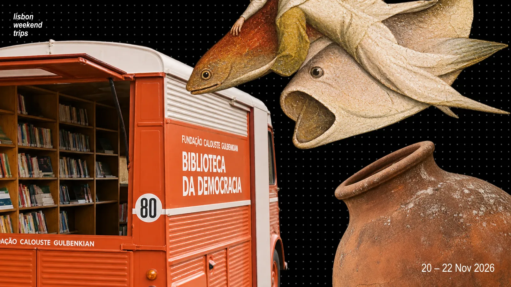
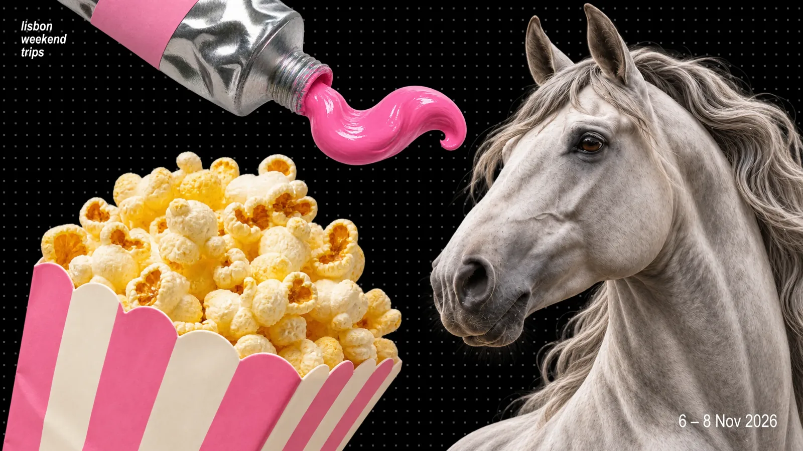
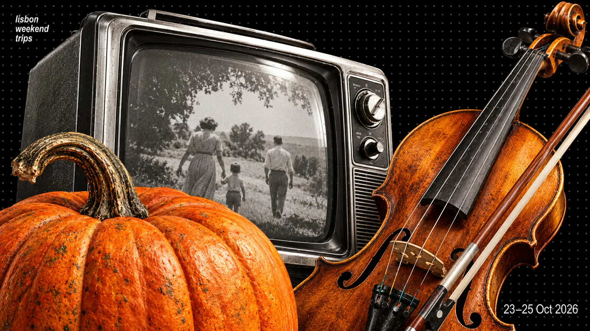
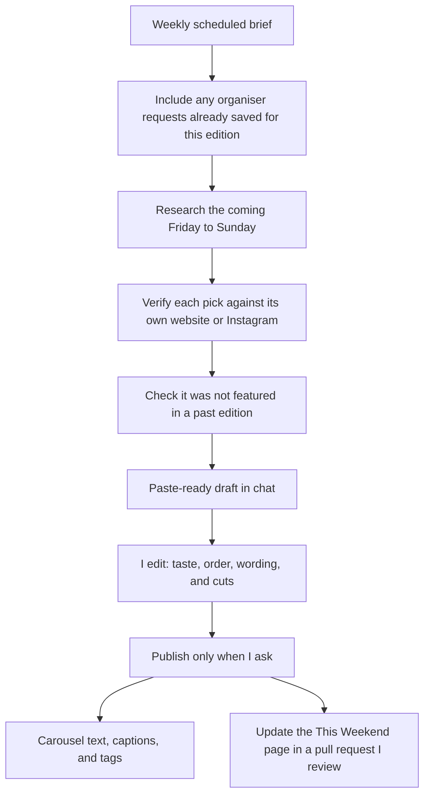
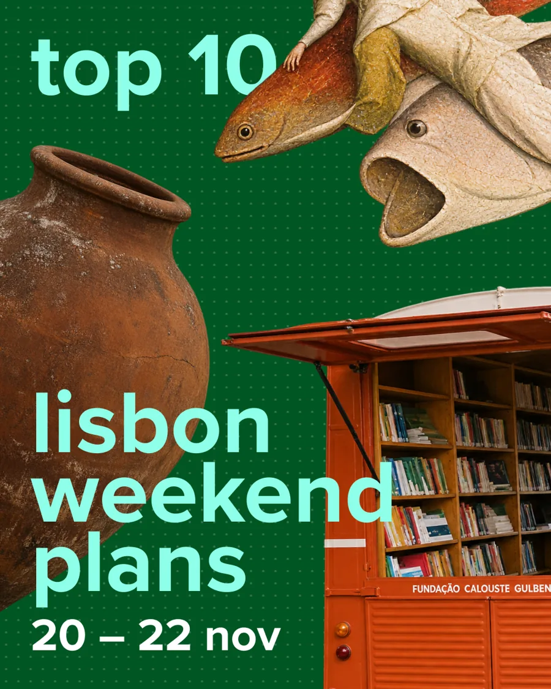
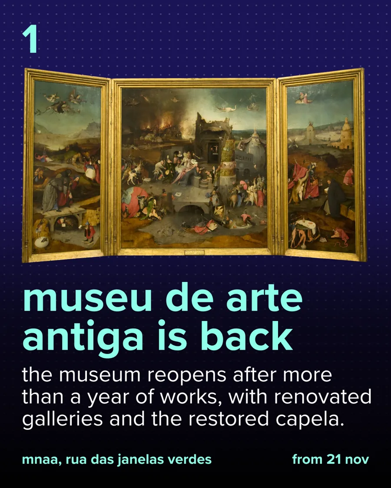
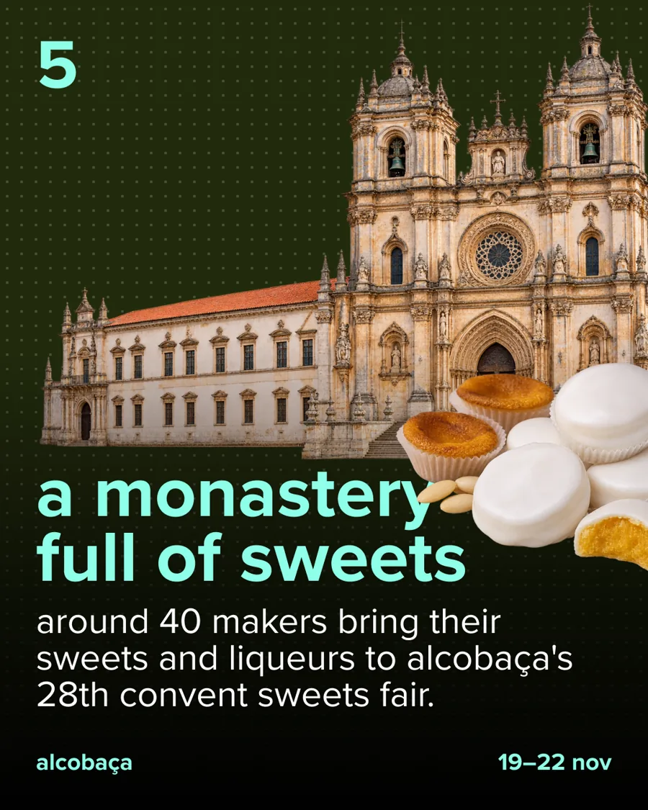

# The Weekend List

Every Thursday I send The Weekend List, a newsletter of things to do in Lisbon and a short drive away. I want about ten verified plans for the coming Friday to Sunday, not a scraped events calendar.

I research, edit and publish this as a one-person project, with an AI assistant running a weekly scheduled brief. The assistant does the research and the first draft. I decide what goes out.

This repo is the brief, the rules that keep it honest, and a record of how those rules have changed. The first edition went out on 17 September 2026. Edition #10 covered 20-22 November 2026.

  
  
  

Covers from editions [#10](https://www.lisbonweekendtrips.com/weekend/10) (Arte Antiga reopens, Misty Fest, convent sweets in Alcobaça), [#8](https://www.lisbonweekendtrips.com/weekend/8) (LEFFEST, Lisbon Art Weekend, Golegã's horse fair) and [#6](https://www.lisbonweekendtrips.com/weekend/6) (home movies, baroque music, a pumpkin escape). Every cover is a collage of that weekend's picks. All editions are in the [archive](https://www.lisbonweekendtrips.com/weekend).

## The problem

Finding ten good weekend plans, every week, takes more time than it looks. Each pick has to be real, still on, and worth leaving the house for. It also cannot be something I already featured.

If I write it from scratch every Thursday, the research crowds out the editing. If I let an assistant work without rules, it invents events, repeats old ones, or fills the list with generic fairs.

The brief exists so the assistant can arrive with a full, sourced draft, and I can spend my time editing.

## How a week works

Times are in Lisbon time. The brief also notes a major Thursday evening when that is part of the weekend.

After the newsletter, the same picks are turned into Instagram and TikTok carousel text, a caption with tags, a TikTok caption without tags, and the [This Weekend](https://www.lisbonweekendtrips.com/this-weekend) page on [lisbonweekendtrips.com](https://www.lisbonweekendtrips.com). Tags are taken only from official sites. The site update arrives as a pull request, so I can review the images and the order before anything goes live.

## Guardrails

Each rule exists to stop a specific failure.

- **Only verified events, with sources.** Invented festivals and guessed dates have no place in the list.
- **Every pick needs its own website or Instagram.** If an event has no page of its own, I cannot send readers anywhere useful, and I cannot check the facts.
- **Never repeat a past event, even as a "last chance" note.** The list should feel new each week. Already-featured events are checked against past editions and earlier drafts.
- **Festivals get one overview, plus a link to the full programme.** A festival is one plan, not a list of single shows. Readers should land on the programme, not one performance page.
- **Out-of-town picks stay within about a two-hour drive.** The list has to work as a weekend from Lisbon, not a travel itinerary.
- **Aim for a full edition.** A short list reads as a bit blank. I want a mix of Lisbon and day trips, across culture, history, nature, festivals, and places people might otherwise miss. Not nightlife only, and not generic municipal or village fairs.
- **Organiser requests are saved and guaranteed a spot in the next edition.** If someone has been in touch, that plan should not get lost in the weekly research.
- **Nothing is published unless I ask.** The assistant delivers a paste-ready draft in chat. It does not send the newsletter or update the live site on its own.

The standing copy and checklist live in [`brief.md`](brief.md) and [`rules.md`](rules.md).

## How the brief has changed

The first brief was a format and a tone. The rules below were added after I edited real drafts.

| Date | Change | What prompted it |
| --- | --- | --- |
| 8 Oct 2026 | Every pick needs its own website or Instagram | Listings with no page of their own, and generic municipal or village fairs, were not useful plans |
| 22 Oct 2026 | Never repeat a past event, not even as a "last chance" note | A pick from an earlier edition should not come back, even if the event is still on or ending that weekend |
| 12 Nov 2026 | Festivals and multi-show events get one overview paragraph that links the full programme | Festival write-ups were naming individual artists and single shows, instead of treating the festival as one plan |
| 23 Nov 2026 | Organiser and partner requests are saved and guaranteed a place in the next edition | People were getting in touch, and those plans needed a reliable way into the following Thursday's list |

The two-hour drive limit was tightened from a looser "within a few hours," so day trips stay realistic for a weekend.

## What I still decide

The assistant can collect and format. It cannot choose for me.

- **Taste.** I keep the striking, fun plans and cut the generic ones. I also check claims that sound off, such as whether a market is actually pet-friendly, or whether two events share a venue.
- **Order.** After edition #10 went out, I changed the order of the ten plans for the website and the social carousel. The assistant had to follow that order, not the newsletter's.
- **Wording.** I rewrite lines until they sound like me. For the Alcobaça slide, that meant shortening a long fair name into a sentence people can read at a glance: "Around 40 makers bring their sweets and liqueurs to Alcobaça's 28th Convent Sweets Fair."
- **What gets published.** I edit the draft in chat, then ask for a newsletter draft or a site pull request when I am ready. I review the pull request before it is merged. The live site does not change until I say so.

  
  
  
  

Four slides from the edition #10 carousel, in the order I set for social. The Alcobaça slide carries the rewritten line above. The Feira das Almas slide says pets are welcome, the kind of claim that gets checked on the organiser's own page before it goes out.

A published pick from edition #1 is in [`examples/weekend-list-1-teatro-d-maria-ii.md`](examples/weekend-list-1-teatro-d-maria-ii.md), so the tone is easy to compare with the brief.

---

Built by [anshka.com](https://www.anshka.com).
